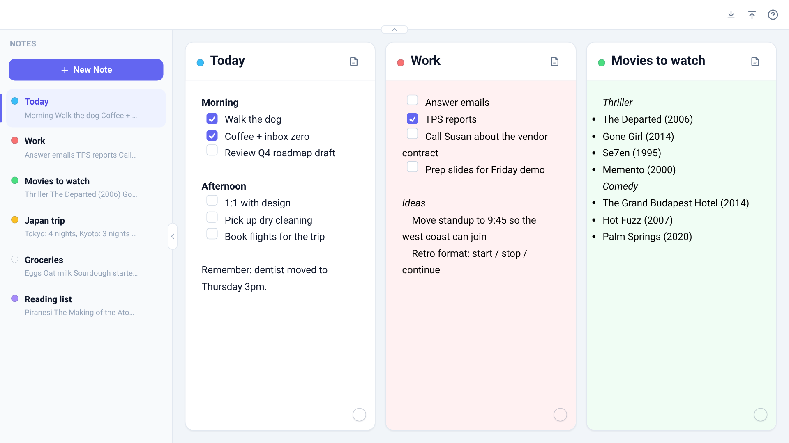
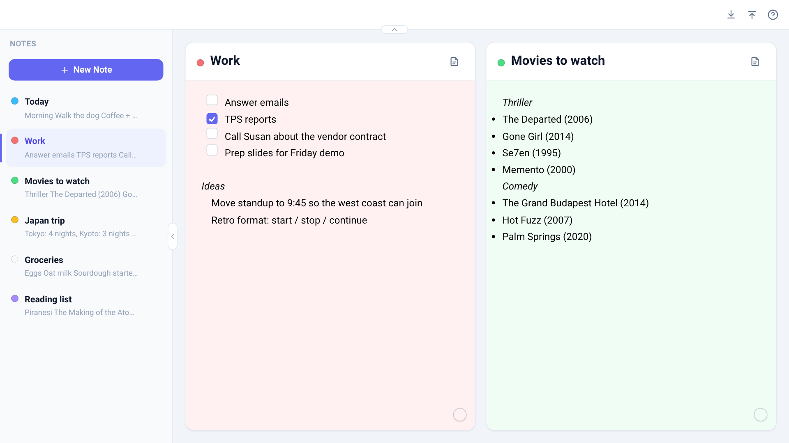
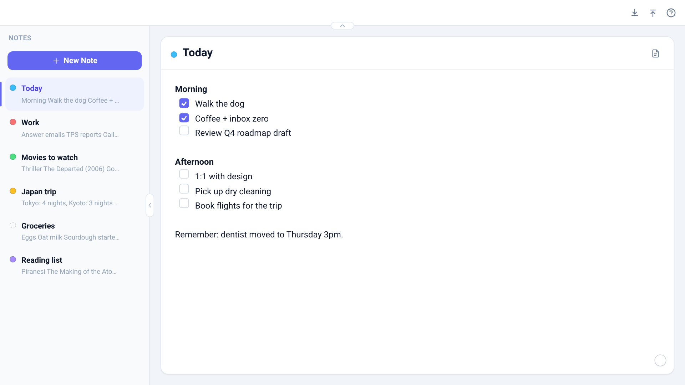
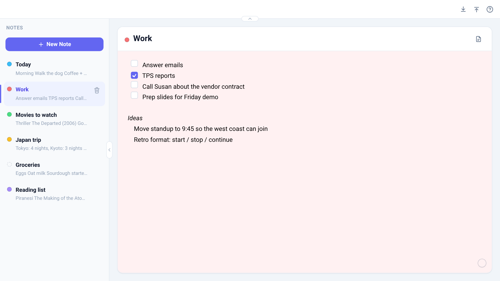
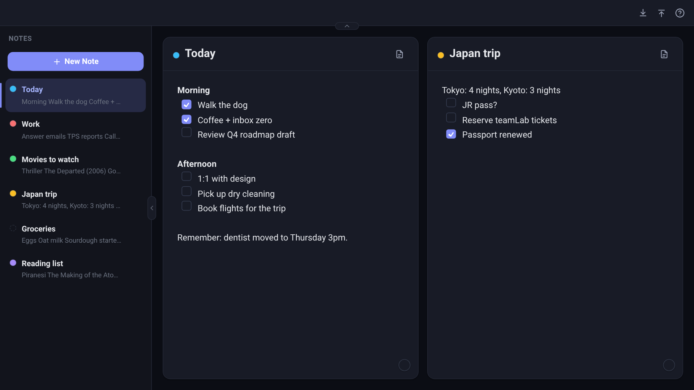
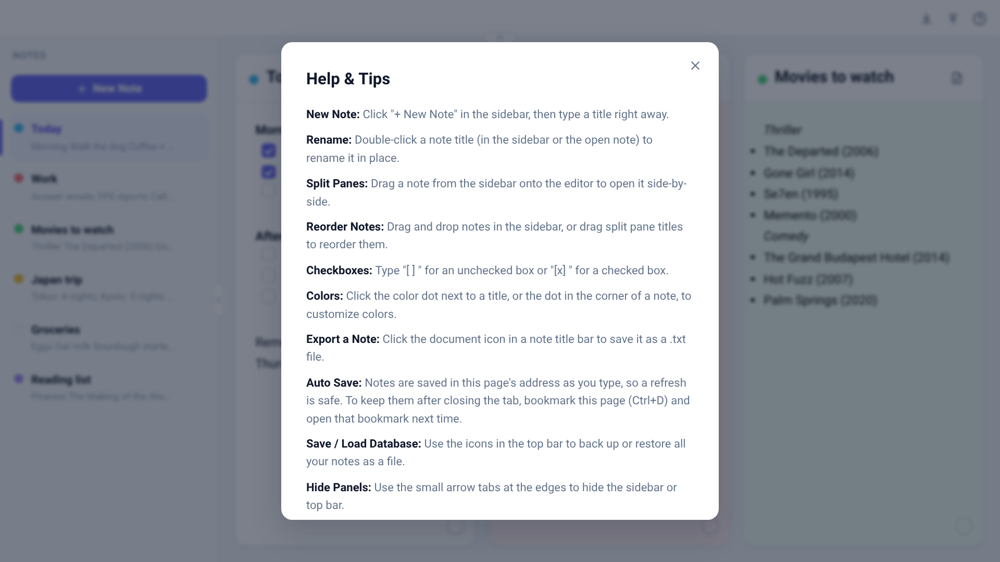

# Note-Taking Bookmarklet

This bookmarklet allows users to take and manage notes directly within a browser, using a simple and intuitive interface. It features note creation and management, split panes, note reordering, auto save, database saving and loading, checkbox interaction, color customization, and dark mode.

## Features

- **Create and Manage Notes**: Add new notes and manage them in a sidebar with a preview of each note.
- **Inline Rename**: Double-click any note title to rename it in place.
- **Split Note Pane**: Split notes into multiple panes for side-by-side comparison or multitasking.
- **Reorder Notes**: Drag and drop notes in the list to reorder them.
- **Auto Save**: Notes are saved into the page's address as you type, so they survive a refresh. Bookmark the page to keep them after closing the tab.
- **Save and Load Database**: Back up all your notes to a file and restore them later.
- **Checkbox Support**: Add interactive checkboxes within your notes. Type `[ ]` for an unchecked box, or `[x]` for a checked box.
- **Color Customization**: Set custom colors for each note's title dot and page background.
- **Reordering Split Panes**: Rearrange the order of split note panes.
- **Save as Text File**: Export individual notes as text files.
- **Copy/Paste HTML Support**: Copy and paste HTML content directly into notes.
- **Toggle Sidebar and Top Bar**: Use the arrow tabs to hide/show the sidebar and top bar for more focused note-taking.
- **Dark Mode**: Follows your system's light/dark setting.
- **Help Overlay**: Accessible guide and tips for using the bookmarklet's features.

## Installation

1. Copy [bookmarklet.html](https://raw.githubusercontent.com/pwillia7/Text_Bookmarklet/main/bookmarklet.html) to your clipboard.
2. Paste the bookmarklet into your address bar.
3. Save the bookmarklet as a bookmark.
4. Click on the bookmark to open the note-taking interface in your current browser window.

## Usage

### Creating and Editing Notes

1. Click **+ New Note** in the sidebar and type a title, then press `Enter`.
2. Click on a note in the sidebar to open and edit it in the main content area.
3. Double-click a note title (in the sidebar or the open note) to rename it.

### Keeping Your Notes

Browsers don't allow `data:` pages like this bookmarklet to use local storage, so the notes are saved into the page's address (the part after `#`) as you type.

- **Refresh**: Your notes are restored automatically.
- **Closing the tab**: Bookmark the page (`Ctrl+D` / `Cmd+D`) before closing, and open that bookmark next time to get your notes back. Reopening a closed tab or restoring your browser session also works.
- **Backups**: Click the download icon in the top bar to save all notes to a file, and the upload icon to load them back.

Opening the original bookmarklet always starts with a blank set of notes, because a page can't update its own bookmark.

### Splitting and Reordering Notes

- Drag a note from the sidebar onto the editor to open it in a split pane.
- Drag and drop notes in the sidebar, or drag split pane titles, to reorder them.

### Working with Checkboxes

- Type `[ ]` for an unchecked box, or `[x]` for a checked box, which will convert to interactive checkboxes.

### Customizing Colors

- Click the color dot next to a note's title to set its color.
- Click the dot in the bottom corner of a note to set its page color.

### Exporting Notes

- Click the document icon in a note's title bar to save it as a text file.

## Screenshots

### Split Note Panes

### Checkbox Interaction

### Color Customization

### Dark Mode

### Help Overlay

## Known Issues

- Checkboxes need a note reload to appear after being entered.
- Notes live in the page address and in the browser tab, not on disk. Bookmark the page or use Save Database to keep them long-term.

## Contributing

Contributions, issues, and feature requests are welcome. Feel free to check [issues page](https://github.com/pwillia7/Text_Bookmarklet/issues) if you want to contribute.

## License

Distributed under the MIT License. See `LICENSE` for more information.
