# Note-Taking Bookmarklet

This bookmarklet allows users to take and manage notes directly within a browser, using a simple and intuitive interface. It features note creation and management, day schedules, split panes, note reordering, auto save, database saving and loading, checkbox and bullet lists, color customization, and themes.

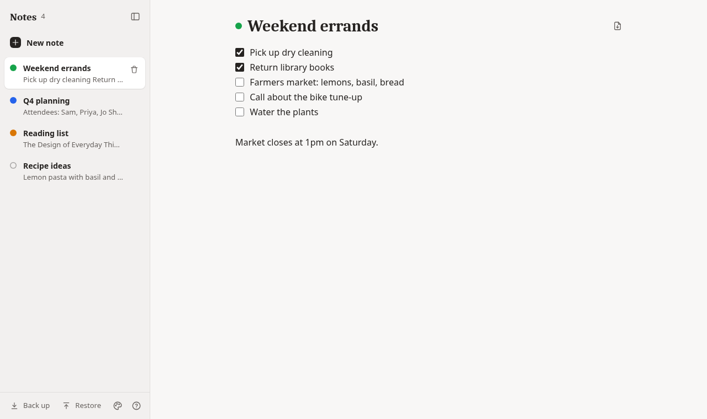

## Features

- **Create and Manage Notes**: Add new notes and manage them in a sidebar with a preview of each note.
- **Schedules**: Plan a day on a timeline. Type events in plain language (`9:30 Standup`, `2-3pm Gym`, `Lunch at 12 for 1h`), drag to move and resize, check them off, and get a reminder when one starts. Export to your calendar (.ics), copy the agenda as text, or roll unfinished events to the next day.
- **Inline Rename**: Click the open note's title (or double-click a note in the list) to rename it in place.
- **Split Note Pane**: Split notes into multiple panes for side-by-side comparison or multitasking, and close panes you no longer need.
- **Reorder Notes**: Drag and drop notes in the list to reorder them.
- **Auto Save**: Notes are saved into the page's address as you type, so they survive a refresh. Bookmark the page to keep them after closing the tab.
- **Save and Load Database**: Back up all your notes to a file and restore them later.
- **Checkboxes and Bullets**: Type `[ ]` or `[x]` and a space for an interactive checkbox, or `*` / `-` and a space for a bullet. Press Enter to continue the list.
- **Color Customization**: Pick a label color and a page color for each note from preset swatches or a custom color.
- **Reordering Split Panes**: Rearrange the order of split note panes.
- **Save as Text File**: Export individual notes as text files.
- **Copy/Paste HTML Support**: Copy and paste HTML content directly into notes.
- **Focus Mode**: Hide the notes list with the panel button or `Ctrl+\` for distraction-free writing.
- **Mobile Friendly**: On narrow screens the notes list becomes a slide-out drawer.
- **Themes**: Pick from seven themes based on [Figma color palettes](https://www.figma.com/color-palettes/). The default, Blank Page, is monochromatic and follows your system's light/dark setting; Spring, Cascade, Driftwood and Rose are light, Walnut and Forest are dark.
- **Help Overlay**: Accessible guide and tips for using the bookmarklet's features.

## Installation

1. Copy [bookmarklet.html](https://raw.githubusercontent.com/pwillia7/Text_Bookmarklet/main/bookmarklet.html) to your clipboard.
2. Paste the bookmarklet into your address bar.
3. Save the bookmarklet as a bookmark.
4. Click on the bookmark to open the note-taking interface in your current browser window.

## Usage

### Creating and Editing Notes

1. Click **New note** in the sidebar and type a title, then press `Enter`.
2. Click on a note in the sidebar to open and edit it in the main content area.
3. Click the open note's title, or double-click a note in the sidebar, to rename it.

### Keeping Your Notes

Browsers don't allow `data:` pages like this bookmarklet to use local storage, so the notes are saved into the page's address (the part after `#`) as you type.

- **Refresh**: Your notes are restored automatically.
- **Closing the tab**: Bookmark the page (`Ctrl+D` / `Cmd+D`) before closing, and open that bookmark next time to get your notes back. Reopening a closed tab or restoring your browser session also works.
- **Backups**: Click **Back up** at the bottom of the sidebar to save all notes to a file, and **Restore** to load them back.

Opening the original bookmarklet always starts with a blank set of notes, because a page can't update its own bookmark.

### Planning Your Day with Schedules

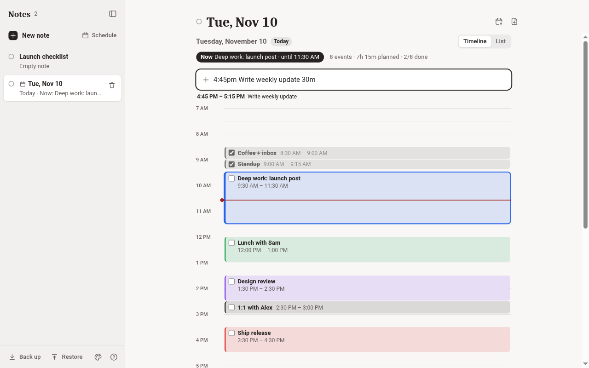

1. Click **Schedule** next to **New note**. The new schedule is for today, or for the next day that doesn't have one yet.
2. Type an event in the box and press `Enter`. The line below the box shows how your text will be read before you add it:
   - `9:30 Standup`, `Standup 9:30`, `9am Standup`
   - `9-10:30 Deep work`, `2-3pm Design review`, `Gym 6pm-7pm`
   - `Lunch at 12 for 1h`, `Dentist @ 4:15 for 45 min`
   - With no time, an event goes after your last one (or from now, if that's later). Events are 30 minutes unless you give an end time or a length.
   - A bare hour from 1 to 6 means afternoon (`2-3 review` is 2-3 PM); add `am` if you mean morning.
3. Paste several lines at once (for example, a checklist copied from a note) to add them all. List markers like `-`, `*` and `[ ]` are stripped, and `[x]` lines come in already done.
4. On the timeline:
   - Drag an event to move it and drag its bottom edge to resize it, in 15-minute steps.
   - Click empty time to add a 30-minute event, or drag across empty time to choose its length.
   - Click an event to rename it, change its times or color, mark it done, or delete it. Deleting can be undone from the message that appears.
   - With an event focused, `Alt+↑` / `Alt+↓` moves it 15 minutes, adding `Shift` changes its end time instead, and `Delete` removes it.
5. Switch to **List** for an agenda with the free time between events.
6. Click the date under the title to move the plan to another day.

While the tab is open, today's schedule shows a red line at the current time and a **Now** / **Next** badge, the notes list shows what's happening now or next, and a reminder pops up when an event starts.

- **Export to calendar**: the calendar icon in the title bar saves an .ics file you can import into Google Calendar, Outlook or Apple Calendar.
- **Copy agenda**: copies the plan as text, ready to paste into a standup message.
- **Plan next day**: starts a schedule for the following day with this day's unfinished events.

### Splitting and Reordering Notes

- Drag a note from the sidebar onto the editor to open it in a split pane.
- Drag and drop notes in the sidebar, or drag split pane titles, to reorder them.
- Click the × in a pane's title bar to close it.

### Checkboxes and Bullets

- Start a line with `[ ]` (unchecked) or `[x]` (checked) followed by a space, and it turns into a checkbox right away.
- Start a line with `*` or `-` followed by a space to make a bullet (`•`).
- Press `Enter` on a checkbox or bullet line to add the next item; press `Enter` on an empty item to end the list.
- `Ctrl+↑` / `Ctrl+↓` moves a checkbox line up or down.

### Customizing Colors

- Click the color dot next to a note's title (in the sidebar or the open note) to choose its label and page colors.

### Changing the Theme

- Click the palette button at the bottom of the sidebar and pick a theme. Your choice is saved along with your notes.

### Exporting Notes

- Click the page icon in a note's title bar to save it as a text file. For a schedule, this saves the agenda.

## Screenshots

### Split Note Panes
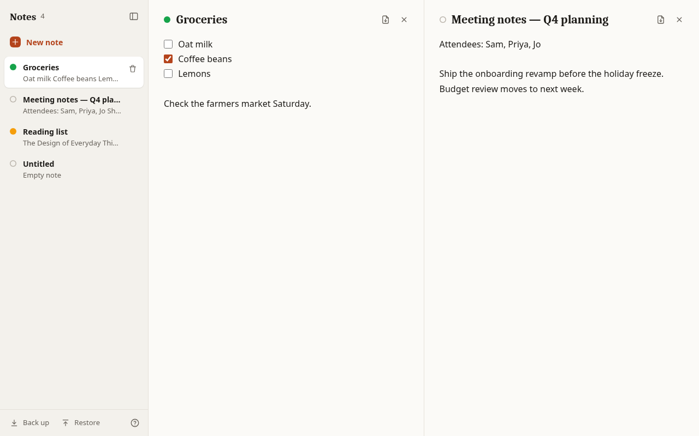

### Checkbox Interaction
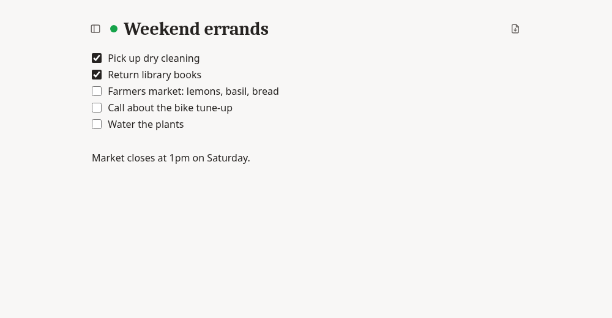

### Color Customization
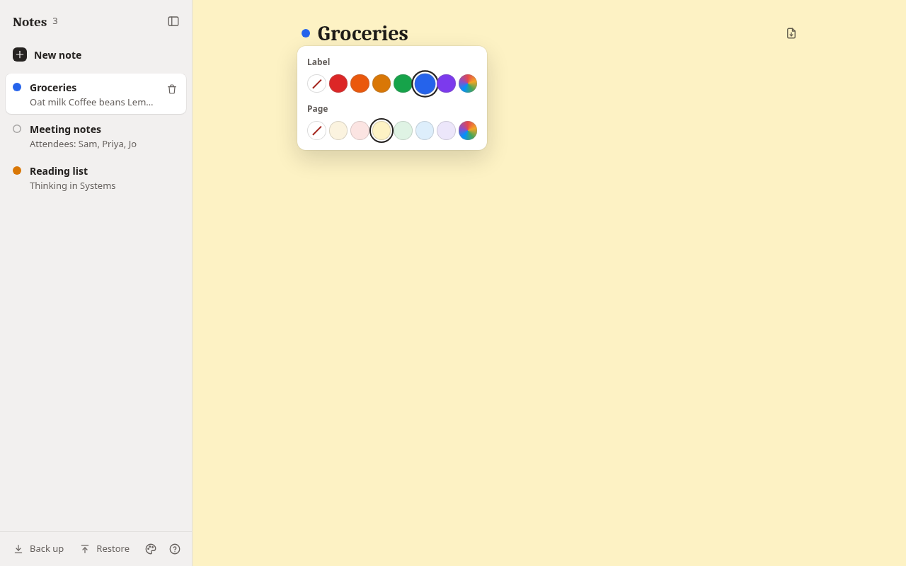

### Themes
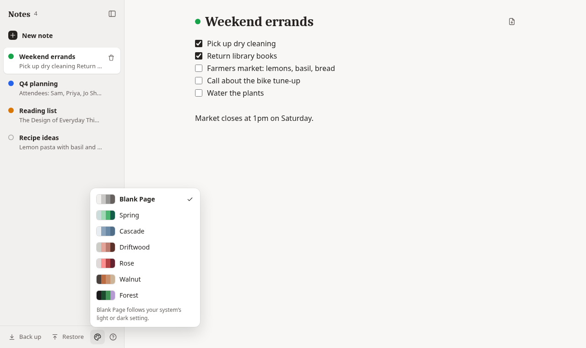

| Spring | Rose |
|---|---|
| 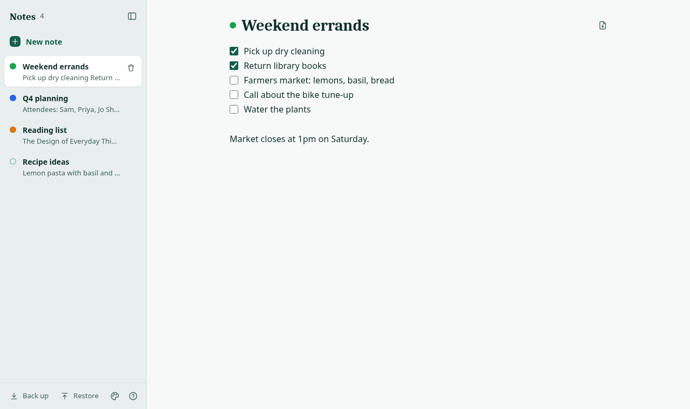 | 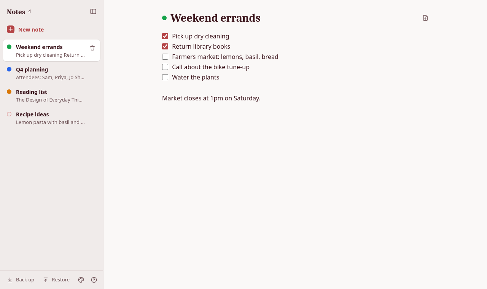 |
| **Walnut** | **Forest** |
| 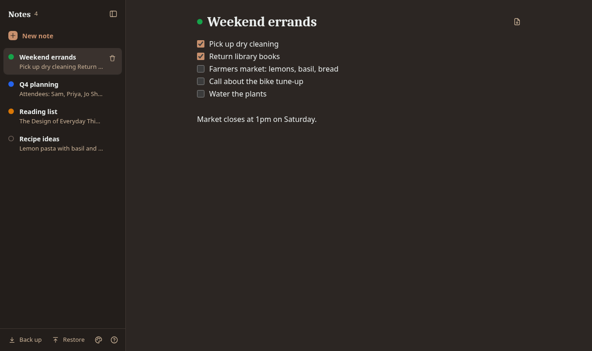 | 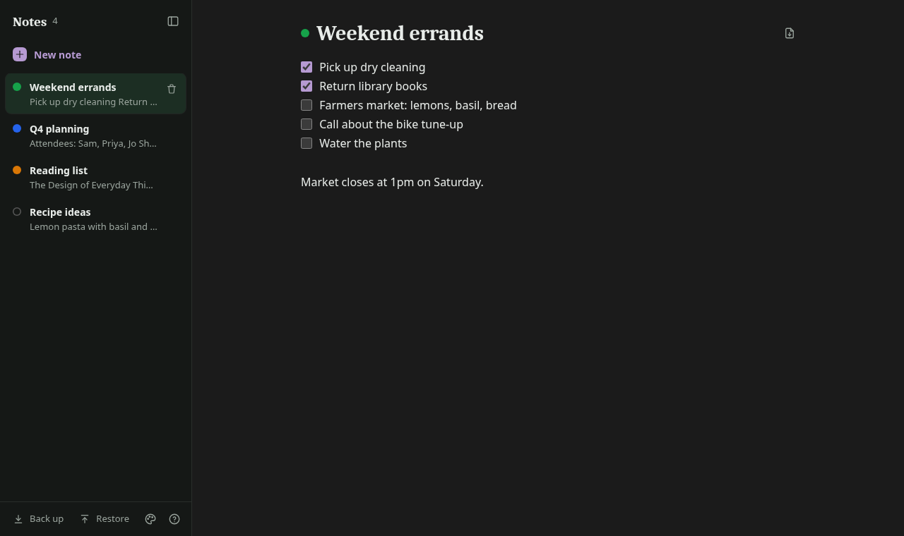 |

### Dark Mode
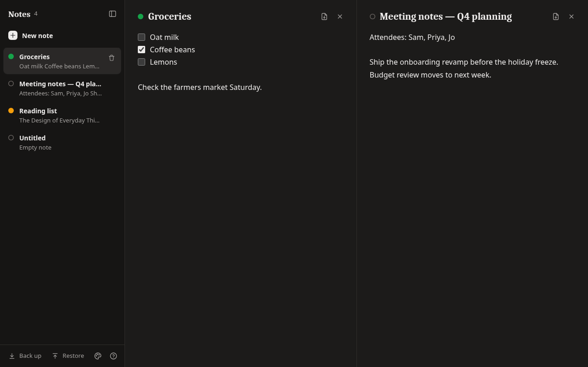

### Help Overlay
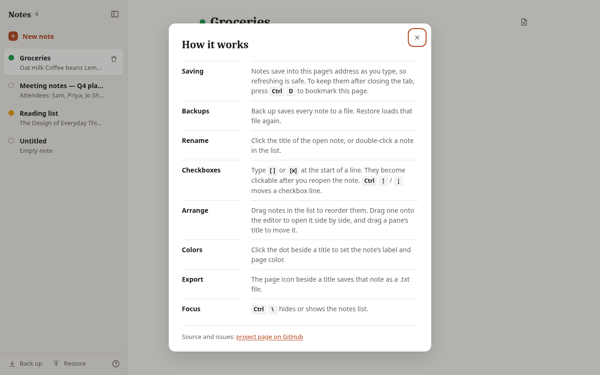

### Mobile
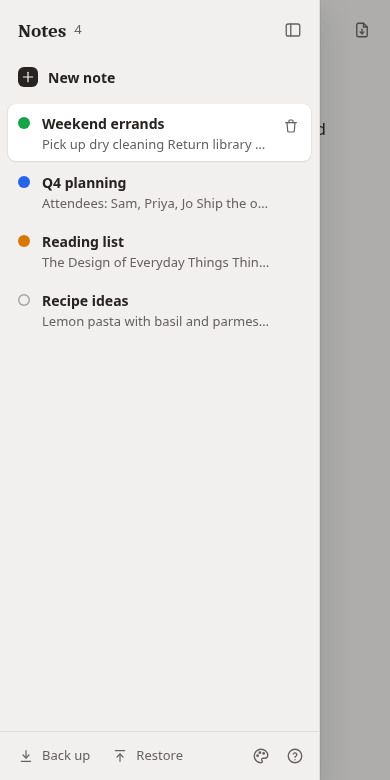

## Known Issues

- Notes live in the page address and in the browser tab, not on disk. Bookmark the page or use Save Database to keep them long-term.

## Building

`bookmarklet.html` is generated. Edit `src/bookmarklet.src.html` (readable HTML/JS) and `unpacked.css`, then run:

```bash
node src/build.js
```

The script URL-encodes the CSS, escapes `#` as `%23`, and refuses to build if the source contains non-ASCII characters, stray `%XX` escapes, or `//` comments (browsers strip newlines when the bookmarklet is pasted into the address bar).

## Contributing

Contributions, issues, and feature requests are welcome. Feel free to check [issues page](https://github.com/pwillia7/Text_Bookmarklet/issues) if you want to contribute.

## License

Distributed under the MIT License. See `LICENSE` for more information.
